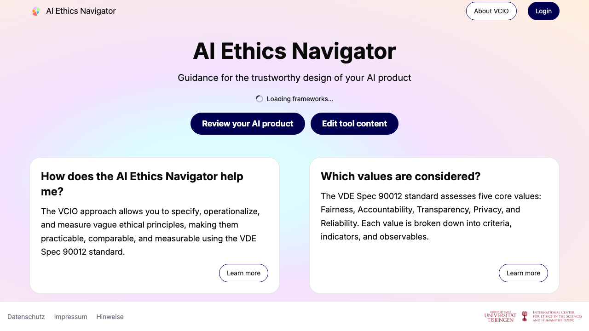
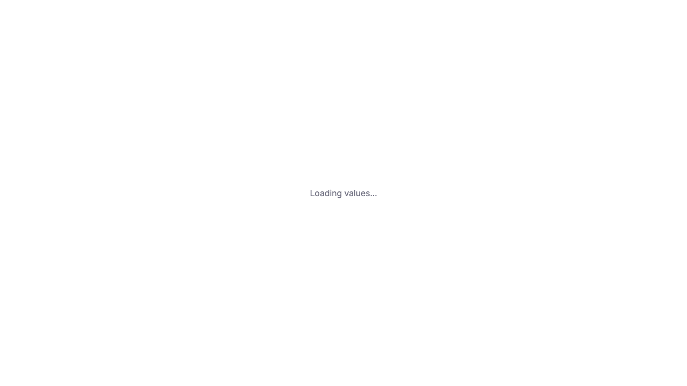
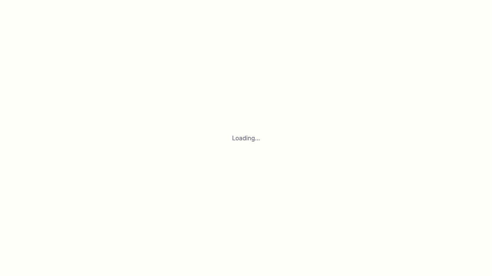

# AI Ethics Navigator

The AI Ethics Navigator is a prototype for an interactive, web-based tool intended to support teams and decision-makers in the development and assessment of trustworthy AI products. It provides a guided way to work with ethical principles: users can explore a framework, answer assessment questions, discuss their judgments, and review the results through an AI Ethics Label.

The prototype uses the VDE SPEC 90012 as its initial example. This standard draws on the VCIO model (**Values, Criteria, Indicators, and Observables**) which structures the path from broad ethical commitments to aspects of a system that can be assessed. The tool is designed to make that structure easier to navigate while leaving room for deliberation and adaptation.

The framework is not fixed to one universal question set. Its contents can be changed and extended using the **AI Ethics Editor**. This makes it possible to adapt the assessment to different audiences, organizational needs, and application contexts.

## Why this tool exists

A persistent challenge in responsible AI is the **principle-to-practice gap**: ethical principles may be widely endorsed, yet translating them into concrete requirements, development practices, and meaningful evaluations of real systems is difficult and context-dependent.

The Navigator was conceived as a way to make that translation more accessible and interactive. Using the VCIO structure, it connects high-level values to criteria, indicators, and observables, then presents those elements through an interactive assessment. In this way, the tool can support teams as they make ethical considerations more explicit, examine available evidence, and identify areas that warrant further discussion or action.

An assessment does not, by itself, determine whether an AI system is ethical or trustworthy. The resulting judgments depend on context, evidence, and stakeholder deliberation. The Navigator is intended as a structured aid to that work. Its editable contents are important for this reason: organizations can revise or extend the question set when their standards, requirements, or application contexts differ.

## What you can do

- **Explore an ethical framework:** Review values and their associated criteria, indicators, observables, and questions.
- **Complete a guided assessment:** Record answers about an AI product and track progress across the framework.
- **Use the AI assistant:** Request explanations, illustrative examples, or relevant guidance while considering a question. (In this demo, assistant responses are currently prepared demo content rather than live AI-generated advice.)
- **Collaborate around questions:** Use the prototype's team and question collaboration features, including assigning questions and adding comments. (In this demo, these are demo interactions and do not provide live multi-user synchronization.)
- **Review the AI Ethics Label:** See an overall assessment summary and a breakdown across values. The label is an indicative presentation of the recorded assessment, not an independent certification of a system.
- **Export a report:** Download a PDF report of the assessment for discussion or record-keeping.
- **Adapt the framework:** Use the AI Ethics Editor to change or extend the assessment content.

## The tool

This publication edition is a local prototype.

### Landing page

The landing page introduces the Navigator and provides access to the assessment and supporting information.



### Values overview

The overview presents the assessment values and shows progress through the questions.



### Guided questions

Questions let users consider how a product's design and practices relate to the selected value. The demo also provides assistant guidance and question-level collaboration controls.


### AI Ethics Label

The label page summarizes the assessment with an overall rating and a breakdown by value. Use it as a communication and reflection aid, rather than as a guarantee or certification of trustworthiness.



## How to use the assessment

1. Choose the AI product or use case you want to examine.
2. Review the values and the questions associated with each one.
3. Answer based on the product and the evidence available to your team.
4. Use the assistant, comments, or question assignments to support discussion in the demo.
5. Review the progress and AI Ethics Label, then discuss findings and possible next steps.

The assessment is most useful when judgments are supported by evidence and reviewed by people with relevant knowledge and perspectives. A rating should be interpreted in light of the assessment scope, the selected framework content, and the context in which the AI system will be used.

## Values in the example framework

The VDE SPEC 90012 example covers five core values:

- Fairness
- Accountability
- Transparency
- Privacy
- Reliability

The Navigator uses the VCIO model to connect these values to more specific elements for assessment. As the project is intended to be adaptable, the framework content can be revised through the AI Ethics Editor rather than treated as the only possible set of values or questions.

## Who it is for

The prototype may be useful to:

- AI product teams and decision-makers
- UX designers, researchers, and developers
- Governance, compliance, and ethics groups
- Organizations exploring trustworthy AI practices
- Educators, students, and workshop facilitators
- Stakeholders who need a structured basis for discussion

## Running it locally

To run the application on your machine, install its dependencies and start the development server:

```bash
npm install
npm run dev
```

Open the local address printed in the terminal, typically `http://localhost:3000`.

To create a production build:

```bash
npm run build
```

The generated files are written to the `build/` directory.

## Acknowledgments

This tool is part of the research and development project ANKER (November 2023–October 2026), funded by the German Federal Ministry of Research, Technology and Space (BMFTR) under funding number 16SV9223 and managed by the Project Management Agency VDI/VDE Innovation + Technik GmbH. The authors are responsible for the content of this publication.
